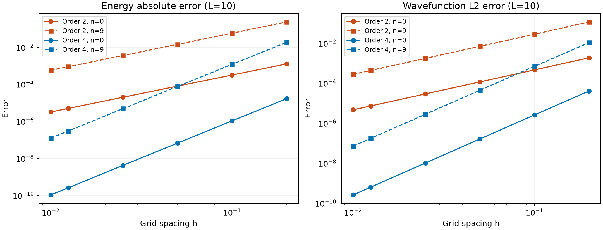
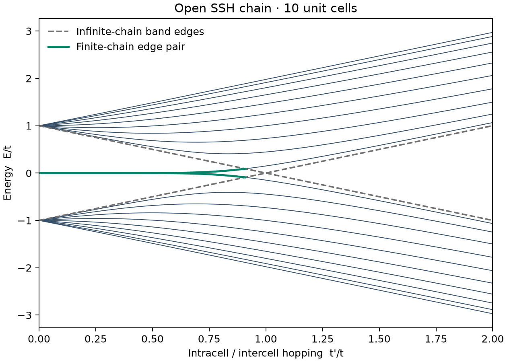

# 论文复现项目进展

截至 2026-11-22，本项目已完成两例既有案例的入口和证据验收，并新增一次独立任务盲测。下面保留第一阶段结论及最新验收矩阵。

以下第一阶段历史计算与交付验收截至 2026-11-14。两例完整报告分别为[一维谐振子](cases/ho-fd4-section21/report.md)和[普通 SSH](cases/delplace2011-fig6/README.md)。

**目标。** 将论文复现原型聚焦于成熟简单量子模型的小规模线性本征值问题，计算能级、能带或波函数，并以解析解、近似解或明确极限核验。第一例选已有原文、程序及解析解的一维谐振子。

**完成与证据。** [原文] 《四阶精度差分法解定态薛定谔方程》§2.1，PDF 页序 2–3／印刷 59–60 页，式 (13)–(20) 及表 1。Codex 对照原文核查单位、边界、矩阵系数及 40 个刊载值。公式与实现相符，本轮沿用现有求解器与配置。流程已收窄至 2.0 版。配置、图、数据、环境及命令索引见[本轮检查记录](records/stage1-check-20261114.json)。

| [推导] 程序验证 | 本轮结果 |
|---|---|
| 论文表 1 | 40/40 个能量值在刊载六位小数上一致。相对刊载值的最大绝对偏差为 4.86×10⁻⁷（能量单位 ℏω） |
| 解析解与网格收敛 | 前十态的能量、波函数误差分别呈预期的二阶、四阶收敛。h=0.01 时四阶能量最大绝对误差为 1.21×10⁻⁷ |
| 边界与归档 | 连续边值法独立抽查 3 个能级。19/19 数值检查、10/10 归档回读通过，退出 0。计算与绘图约 28 秒 |
| 项目复查 | 既有两例分享证据回读 22/22。GPD 1.2.2 的版本、工作区状态查询和报告格式校验可执行，当前无 GPD 项目状态 |

**迁移与交付。** [推导] 流程 2.0 已用于 Delplace 等人的普通 SSH 图 6，9 项检验全部通过。与原解析方程所得能量的最大绝对差为 4.55×10⁻¹²（E/t），谱线结构、近零能态及无限链带边已对照刊印版。冻结流程之前已查看图注和部分公式。在独立交付副本中用官方 PyPI 的 14 个锁定软件包从空环境安装，两例均重跑通过，本征数组与先前逐字节一致。[迁移记录](cases/delplace2011-fig6/README.md) · [交付验收](records/stage1-delivery-20261114.json)

**待核验。** [未知] 两篇作者原始数组均未取得，谐振子与论文数值的比较限于刊载六位小数，SSH 定量比较基于原解析方程。用户自评已掌握谐振子和普通 SSH，原文核查、程序运行及报告由 Codex 完成。交付验收覆盖本机 Windows 和 CPython 3.13。

**下一步。** 请导师指定一个同范围的论文目标，检验工作流在外部指定任务上的适用性。

**一维谐振子结果图。** [推导] 左图为能量绝对误差，右图为波函数 L² 误差，横轴为步长 h。数据来自既有运行，2026-11-14 重跑的本征数组与该运行逐字节一致。二阶和四阶误差的拟合区间、斜率和验收阈值见[完整报告](cases/ho-fd4-section21/report.md)。

**普通 SSH 结果图。** [推导] 横轴为胞内与胞间跃迁比 t′/t，纵轴为 E/t，共 10 个原胞、20 条能量分支。绿色突出有限链的近零能边界态分支，灰虚线表示无限链带边。数值与原文解析方程的对照见[完整报告](cases/delplace2011-fig6/README.md)。

## 2026-11-22 项目验收矩阵

| 能力 | 判定 | 依据 |
|---|---|---|
| 已有案例空目录重跑、输入失败阻断、实际命令记录 | 通过 | [两例回归与错误注入](_acceptance/20261122-entry-audit/acceptance/results.json) |
| 独立物理核验 | 通过 | [SSH 逐级谱](_acceptance/20261122-entry-audit/acceptance/delplace2011-fig6/A/independent-ssh.json)、[Kronig 带边](_acceptance/20261122-entry-audit/acceptance/kronig-penney1931-fig3/A/bloch-fem.json) |
| 新论文盲测 | 通过 | [Vankov 图 1 独立提交](cases/vankov2009-fig1/report.md)、[五点评分](_acceptance/20261122-entry-audit/blind-score.json) |
| 原图定量对照 | 部分通过 | [SSH 图 6 最高支三个点](_acceptance/20261122-entry-audit/figure6-points.json)，Kronig 本轮未逐点数字化 |
| 环境覆盖 | 部分通过 | [Windows 两套 Python 和两个 PowerShell 版本的实际记录](_acceptance/20261122-entry-audit/report.md)。本轮未在空环境重装或跨平台执行 |
| Roy 表 II | 未测 | 本次指定重跑目标为 SSH 与 Kronig。[历史报告](cases/roy2013-h2-table2/report.md)记录了解析核验及刊载精度偏差 |

案例资料见 [SSH 图 6](cases/delplace2011-fig6/README.md)、[Kronig 图 3](cases/kronig-penney1931-fig3/report.md)。重跑方法见[根目录运行说明](README.md)。完整证据和未测边界见[本轮验收报告](_acceptance/20261122-entry-audit/report.md)。
