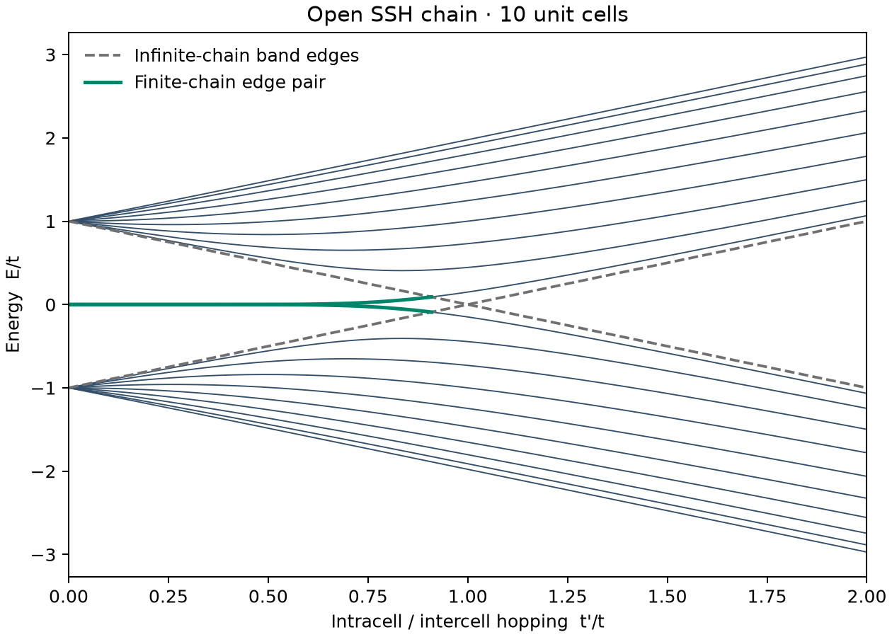

# 普通 SSH · 图 6 复现与迁移报告

本报告包含计算能谱、原文对照、验证结果和流程迁移记录。项目整体结果见[第一阶段复现报告](../../PROGRESS.md)。

[原文] 按 Delplace、Ullmo 和 Montambaux 的 §II.B，求 10 胞普通 SSH 开链的 20 条能量随胞内外跃迁比 t′/t 的变化。[条件与出处](extraction.md) · [原文图 6，PDF 页序 4／印刷 195452-4](https://arxiv.org/pdf/1109.4608#page=4)



[推导] 最终 9/9 项通过。扫过 801 个比值并另算临界点，与原文边界方程独立求根得到的能谱相比，最大绝对差约 4.55×10⁻¹²（E/t）。两组边界态概率与原解析形状的最大绝对差约 4.91×10⁻¹⁴。主步长 0.005 下，谱线线性插值在加密中点的最大误差约 9.78×10⁻⁶。二聚体与均匀链解析极限均通过。

[推导] 以同一有限链的本征能量与无限链带边 ±|t′/t−1| 比较，t′/t=0.8 时有两个带隙内态，0.95 时没有。临界值为 10/11，由原文式 (15) 给出。

[原文] 刊印版图 6 在横轴 0 至 2 上画出关于零能对称的能谱，深浅颜色标出靠近零能的能量分支，虚线给出无限链带边。[推导] 视觉核对确认本图再现 r=0 处的能级并合、近零能分支接触带边和带边在 r=1 处相交。原图以紫线延续高于阈值的近零能分支，本项目在该区间沿用其余能级的颜色。[未知] 作者逐点数据及作图网格缺失，数值精度以原解析式为准。[刊印版图 6](https://gilles.montambaux.com/files/publications/reprints/171_Zak.pdf#page=4)

## 重跑和证据

从项目根目录执行，复用根 README 的 Python 依赖环境。

```powershell
.\.venv\Scripts\python.exe -X utf8 cases/delplace2011-fig6/run.py
```

- [谱数据](evidence/spectrum.csv)和[两轮检查摘要](evidence/checks.json)可直接查看。完整波函数、解析参考、环境、实际命令、退出码、输入快照和哈希保存在 `outputs/` 下。
- [假设] 首轮退出 2，扫描网格产生的 0.95 附近浮点值没有与字面量 0.95 精确相等，指定点计数漏记。复算时显式加入两个计数点，保持物理参数和验收阈值。两轮扫描 CSV 逐字节一致，失败目录保留。
- [推导] 用官方 PyPI 锁定依赖全新安装后，在只有交付文件的副本中重跑，9 项检查通过，谱数据和本征数组与此前逐字节一致。[交付验收记录](../../records/stage1-delivery-20261114.json)

## 流程迁移记录

本轮采用[冻结的流程 2.0 及哈希](records/baseline/record.json)，运行结束逐项校验哈希一致。复用了提取、适用性检查、验收计划及留档步骤。新增的开链矩阵、根方程、极限检查和绘图只在本案例。冻结到验证完成期间通用规则改动为零。

用户提供阶段范围及继续推进的指示，Codex 选择论文与图 6，提取参数、开发并验证程序。沿用同一对话，冻结前完成了候选筛选并读到图注和部分公式，且已接触项目内旧案例。本次是有上下文的迁移测试。GPD 的实测可用范围见[第一轮记录](../../records/stage1-check-20261114.json)，本例由 Python 完成科学计算和验证。
