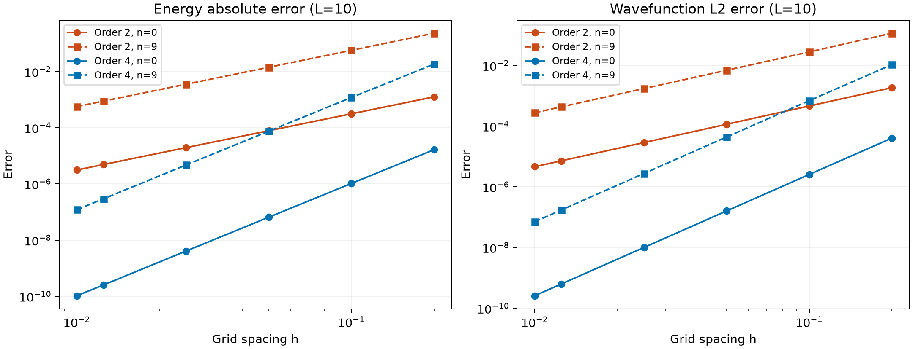

# 四阶差分法 §2.1：一维谐振子

状态为阶段一主案例。2026-11-14 对照原文重新核查条件和表 1，并按同一计划和配置完整重跑。[推导] 40 个刊载值在六位小数精度内一致，19 项数值检查和 10 项归档回读通过。用户自评已掌握，个人理解依据为自评。

学习材料见[阅读指南](reading-guide.md)。运行索引见[首轮检查记录](../../records/stage1-check-20261114.json)，本地完整输出在 `outputs/20261114T125722_353764Z/`。历史首次 BVP 节点预算不足的失败记录仍在 `evidence/` 的 `history/` 中。

技术细节见[条件与原文位置](extraction.md)、[计划及容差](plan.md)、[历史报告](report.md)和[历史验证](verification.md)。

## 本轮复算结论

- [原文] 对照 PDF 页序 2–3／印刷 59–60 页核查式 (3)、(9)、(13)–(20) 和表 1，逐格复核 `source/table1.csv`。`solve_fd` 所用网格、零延拓和矩阵系数与式 (15)–(20) 一致，本轮沿用源码与配置。
- [推导] 相对刊载值的最大绝对差为 4.86×10⁻⁷（能量单位 ℏω）。对前十态用 h=0.1、0.05、0.025 拟合误差阶次，能量为 2.0004–2.0041 和 3.9901–3.9982，波函数为 2.0011–2.0073 和 3.9887–3.9968。L=10 时连续边值法抽查 n=0、3、9，进一步收紧容差后，所有区间和抽查态能量变化最大为 3.58×10⁻¹²。
- [未知] 一致性限于刊载六位小数。作者未舍入能量与波函数数据缺失，波函数图来自本项目计算与解析解比较。小区间的边界闭合对照是按[额外数值设置](extraction.md#推导和补充验证)进行的探索。



## 查看与低成本检查

在项目根目录使用根 README 的依赖安装方法，再执行：

```powershell
.\.venv\Scripts\python.exe scripts/check_shared_evidence.py
```

分享快检只回读精选文件、矩阵本征对和数值表，不需要 PDF。固定运行证据在 [evidence/20261102T151707_448706Z/](evidence/20261102T151707_448706Z/)。其中 `share-manifest.json` 对分享副本校验，`original-manifest.json` 仅是本地完整归档的历史清单。

## 完整重跑

先按 [原文放置说明](source/README.md) 合法取得对应 PDF。现有计算入口会读取 PDF 哈希，故缺少文件不能直接完整运行。然后在项目根目录执行：

```powershell
.\.venv\Scripts\python.exe cases/ho-fd4-section21/src/run.py --config cases/ho-fd4-section21/config.json
.\.venv\Scripts\python.exe cases/ho-fd4-section21/src/audit_run.py
```

`config.json` 是实际采用的配置示例，`requirements-lock.txt` 是记录依赖。每轮新建 `outputs/<UTC时间戳>/`；成功才更新本地 `latest_run.txt`。首次克隆没有该指针，必须先完整运行才能使用案例 `audit_run.py`；展示应使用上面的精选快检。原始科学求解入口此次未修改。

## 分享限制

原文 PDF、全文文本、页面截图与包含原图的旧汇报不上传；本地原件不删除。机器路径在分享副本中脱敏，历史命令中的 `<PROJECT_ROOT>` 等是标记，不能直接粘贴执行。重跑后源码、说明或输入哈希与旧轮不同并不自动意味着物理结果改变，应检查差异。独立核验与科研结论边界见 [项目进展](../../PROGRESS.md)。

本轮计算和绘图约 28 秒，内存峰值未测。历史分享证据包括 `eigenpairs.npz`、`bvp_solutions.npz`、误差及收敛表和三张计算图。[推导] 交付验收用官方 PyPI 锁定依赖全新安装，在交付文件副本中按说明加入原文后重跑，19 项数值检查和 10 项归档回读通过，本征数组与此前逐字节一致。[交付验收记录](../../records/stage1-delivery-20261114.json)
