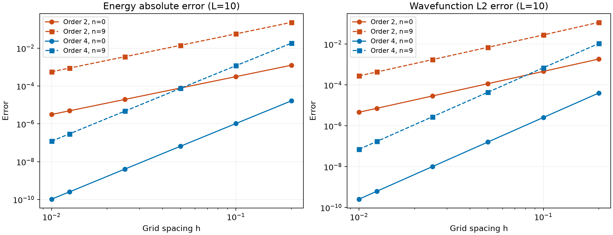

# 四阶差分法 §2.1：一维谐振子

状态：计划已有；代码已生成；已运行；已有程序验证；**无用户独立核验证据**。[推导] 表 1 的 40 个刊载值在六位小数精度内一致；19 项数值检查及历史 10 项归档回读通过。首次 BVP 网格预算不足的失败记录也保留在 evidence 的 history 中。

先读 [条件与原文位置](extraction.md)、[计划及容差](plan.md)、[报告](report.md)、[验证](verification.md)。这些解释由 Codex 整理，不代表用户已独立理解或推导。



## 查看与低成本检查

在项目根目录使用根 README 的依赖安装方法，再执行：

```powershell
.\.venv\Scripts\python.exe scripts/check_shared_evidence.py
```

分享快检只回读精选文件、矩阵本征对和数值表，不需要 PDF。固定运行证据在 [evidence/20261102T151707_448706Z/](evidence/20261102T151707_448706Z/)。其中 `share-manifest.json` 对分享副本校验，`original-manifest.json` 仅是本地完整归档的历史清单。

## 完整重跑（可选）

先按 [原文放置说明](source/README.md) 合法取得对应 PDF。现有计算入口会读取 PDF 哈希，故缺少文件不能直接完整运行。然后在项目根目录执行：

```powershell
.\.venv\Scripts\python.exe cases/ho-fd4-section21/src/run.py --config cases/ho-fd4-section21/config.json
.\.venv\Scripts\python.exe cases/ho-fd4-section21/src/audit_run.py
```

`config.json` 是实际采用的配置示例，`requirements-lock.txt` 是记录依赖。每轮新建 `outputs/<UTC时间戳>/`；成功才更新本地 `latest_run.txt`。首次克隆没有该指针，必须先完整运行才能使用案例 `audit_run.py`；展示应使用上面的精选快检。原始科学求解入口此次未修改。

## 分享限制

原文 PDF、全文文本、页面截图与包含原图的旧汇报不上传；本地原件不删除。机器路径在分享副本中脱敏，历史命令中的 `<PROJECT_ROOT>` 等是标记，不能直接粘贴执行。重跑后源码、说明或输入哈希与旧轮不同并不自动意味着物理结果改变，应检查差异。独立核验与科研结论边界见 [项目进展](../../PROGRESS.md)。

历史计算/绘图约 4.80 秒。分享 `eigenpairs.npz`、`bvp_solutions.npz`、误差/收敛表和三张自生成图。小区间边界比较属探索性扩展；作者没有波函数数据，波函数只做解析验证。当前只说明这一不同模型上的流程迁移，非任意论文自动复现。
