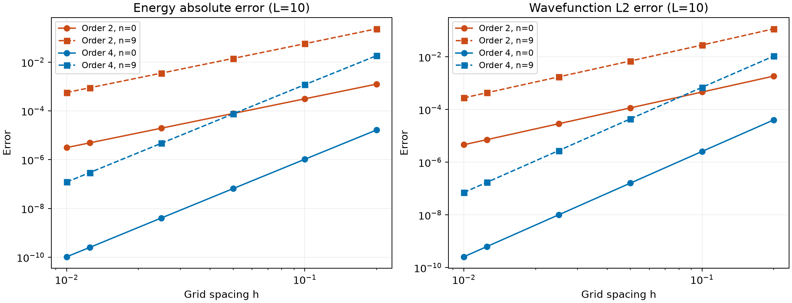
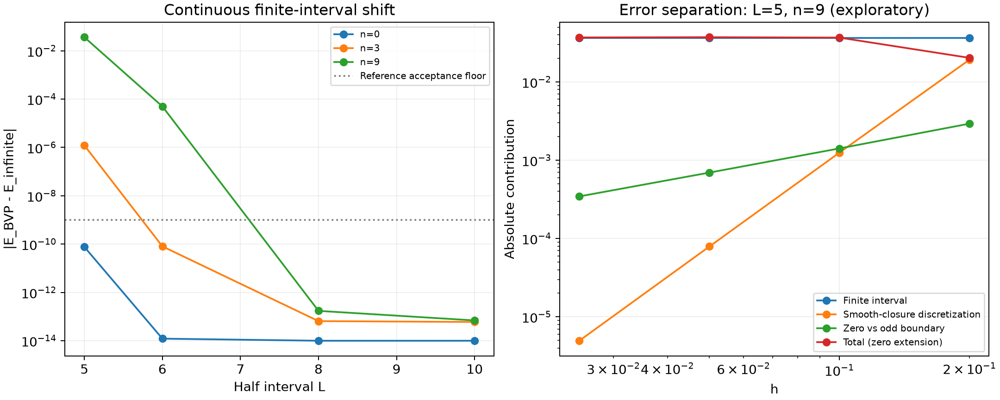

> 发布说明（2026-11-06）：下文是历史运行与程序验证记录；论文与完整 outputs 仅本地保存。精选证据见 [evidence/20261102T151707_448706Z](evidence/20261102T151707_448706Z/)。页面转录和视觉核对由 Codex 执行，不是用户独立核验。

# 第2.1节一维谐振子复现报告

范围：仅一维谐振子，原文PDF第2–3页／印刷59–60页的式(13)–(20)及表1。条件出处与推导见[extraction.md](extraction.md)。固定交付运行为[20261102T151707_448706Z](evidence/20261102T151707_448706Z/)。所有本次数值均标为[推导]，前提为该处模型与config设置。

**[推导] 已复现表1全部40个刊载数值：六位小数舍入后40/40一致。** 同步长下四阶更精确，能量和波函数误差具有预期的二阶／四阶收敛。程序退出0，19/19预定数值检查及10/10归档回读检查通过。这里的定量一致性限于原表显示精度。

| 已运行／验证的指标 [推导] | 二阶 | 四阶 |
|---|---:|---:|
| h=0.1，n=0…9最大能量绝对误差 | 5.6905364×10⁻² | 1.1896783×10⁻³ |
| h=0.01，n=0…9最大能量绝对误差 | 5.6565878×10⁻⁴ | 1.2070677×10⁻⁷ |
| h=0.01，最大波函数L²误差 | 2.7676713×10⁻⁴ | 7.0606775×10⁻⁸ |
| 能量误差拟合阶次（十态范围） | 2.0004–2.0041 | 3.9901–3.9982 |
| 波函数误差拟合阶次（十态范围） | 2.0011–2.0073 | 3.9887–3.9968 |

证据：[逐格表格对照](evidence/20261102T151707_448706Z/table1_comparison.csv)、[逐态指标](evidence/20261102T151707_448706Z/metrics.csv)、[收敛阶](evidence/20261102T151707_448706Z/convergence.csv)、[数值检查](evidence/20261102T151707_448706Z/checks.json)、[保存数组回读](evidence/20261102T151707_448706Z/archive_audit.json)。拟合步长0.1、0.05、0.025在运行前指定；没有按结果重新选取拟合区间。

[推导] 独立参考包含解析Hermite波函数及能级，并用连续ODE自适应配点法独立求有限区间能级。主矩阵相对残差最大2.06×10⁻¹⁵，离散正交误差3.35×10⁻¹⁴，宇称误差7.47×10⁻¹²。残差只验证离散方程；解析比较和连续边值问题负责物理与离散误差验证。

**三类误差。** [推导] 连续BVP与无限区间解析能量的差度量有限区间效应；奇延拓四阶矩阵与BVP之差度量该闭合下的离散误差；原文零延拓与奇延拓之差度量边界处理敏感性。三项相加恢复原文矩阵总误差。边界处理差并非唯一的纯边界误差，奇延拓本身也有截断误差，详见提取文档的推导。

[推导] 在L=10抽查n=0,3,9，连续区间能量偏差及两种闭合差均低于预设10⁻⁹判别尺度；BVP收紧容差后能量变化最大3.59×10⁻¹²。不能把接近浮点精度的差值解释为严格误差上界。对L=10全部十态的能量和波函数均另有解析验证。

[假设] 以下为自选小区间探索，并非论文条件。[推导] L=5、n=9、h=0.025时，有限区间偏差+0.0365729705，奇延拓离散误差−0.00000495465，边界处理差+0.0003449897，总误差+0.0369130055。固定L=5，h由0.1降至0.025，闭合差约按h降低，而平滑闭合离散误差约按h⁴降低。这说明内点四阶公式不能单独保证边界影响显著时的全局四阶精度；也说明细化网格不能消除有限区间偏差。数据见[error_budget.csv](evidence/20261102T151707_448706Z/error_budget.csv)、[BVP参考与状态](evidence/20261102T151707_448706Z/continuous_references.csv)。

**偏差与无法判断。** [原文] 表1后的文字称四阶h=0.1“接近”二阶h=0.01（PDF3/印刷60，左栏末段）；[推导] 本次数值的两者绝对误差比随n为0.332–2.103，不能解读成每个能级精度相等。[未知] 作者未舍入数据、实际求解器及波函数数值未提供，因此不能判断六位小数以下与作者一致，也不能称本次波函数图为作者波函数复现；它是解析验证。

**执行与可复用性。** 未访问或修改manual_check，未修改SSH案例。完整计算及作图实测4.80秒（status计时，不含Python启动、依赖记录及人工阅读），成功归档约7.9MB，内存峰值未测；Python 3.13.14及依赖已锁定。首轮18/19通过但BVP精细网格触顶，退出2；仅将独立验证网格上限20000增至80000后19/19通过，容差与论文条件不变，历史完整保留。

直接复用流程1.1的读取→提取→缺失检查→预设验收→计算→验证→报告、模板结构、独立案例布局、哈希与失败留存要求；通用规则实际修改0项，起始快照与哈希见本地 records/baseline（完整冻结快照未上传）。新写的模型、带状求解、Hermite/BVP检查均在本案例。GPD 1.2.2实际用于验证报告格式校验，未启动完整GPD项目或多agent流程；格式通过不等于科学验证。人工输入仅为论文、目标和隔离要求，没有人工公式、参数或核验结果。

待改进：归档/环境记录已在两案例出现重复，后续可提取小工具；现有GPD仍只有报告级整合；缺少干净环境安装重跑与资源峰值测量。此次只证明流程可用于这一个不同模型的案例，不能证明任意论文自动复现。重跑命令和文件索引见[README.md](README.md)。
