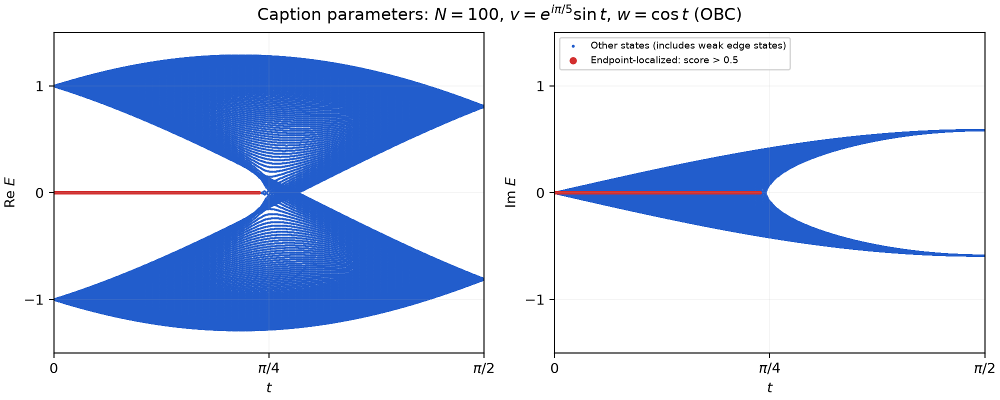
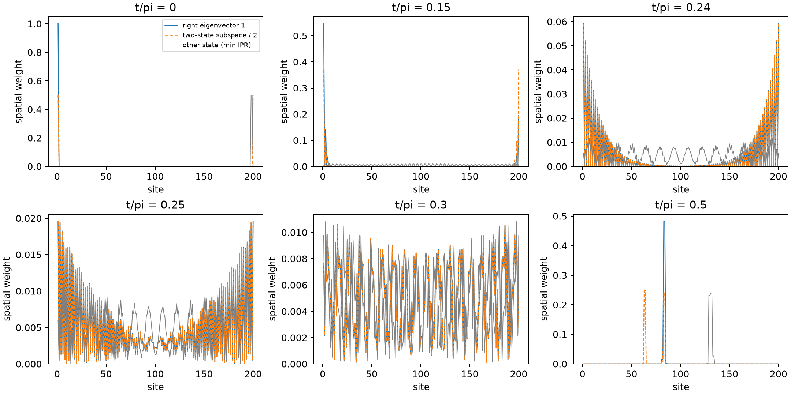

> 发布说明（2026-11-06）：下文保留历史科学记录；原文、完整 outputs 和部分 records 仅本地保存。分享证据见 [evidence/20261102T144055_167379Z](evidence/20261102T144055_167379Z/)。历史原图引用不表示原图已上传；未发现用户独立核验依据。旧轮谱图链接指向物理配置相同的 11 月 2 日固定重跑图，原始历史输出保留本地。

# Lieu 2018 图4复现报告

2026-11-02 补充：本案例为**有详细指导的复现**。本轮重跑和贡献审查见 [阶段贡献说明](../../PROGRESS.md)，简报见 本地一页汇报（含原图，未上传）。下文数值和图片保留为2026-10-30历史报告；新运行 `outputs/20261102T144055_167379Z` 与旧结果的物理配置相同。本报告计算结论均属 `[推导]`，原文条件见 extraction.md 的 `[原文]` 位置表，额外数值选择属 `[假设]`，原因未明处属 `[未知]`。

**已实现、运行并验证图注指定的200格点开放链；不能宣称完整复现论文图4图像。** 发现图注参数与图像端点明显不一致，未通过隐藏调参修正。

## 目标、依据与范围

采用 [arXiv:1709.03788v2](https://arxiv.org/abs/1709.03788v2)，Simon Lieu，PRB 97, 045106 (2018)；原始 PDF 已保存在 source。所有编号以此版本为准。读取并视觉核对 p.1 式(1)(2) 与 p.4 图4；相关正文和附录B也已检查。

图4要求 u=0、v1=v2=exp(iπ/5)sin(t)、w1=w2=cos(t)、N=100；N是原胞数，故有200个格点。基底为(A1,B1,…,AN,BN)，只保留相邻原胞的连接，端点为A1和BN。反向跳跃与正向相同而非复共轭；t是角参数，不是时间。扫描[0,π/2]，绘制全部复本征值的实部与虚部，能量采用图注幅度为1的尺度，不做额外缩放。具体逐项出处及未知项见 [extraction.md](extraction.md)。

没有实现 Berry 相位、图5/6、全文拓扑证明、网页、多 agent 或外部模型API。

## 实际实现与运行

代码 `src/run.py`、配置 `config.json`。一般复数求解器 SciPy eig 求右本征对，非 Hermitian eigh。先通过3胞连接检查，再完成401点主扫描及400个中点补算；只画散点，不假设不同参数下的能级顺序连续。

正式运行（北京时间2026-10-30 23:11开始），输出 [outputs/20261030T151119_484167Z](evidence/20261102T144055_167379Z/)；实际计算耗时46.36秒，退出码0。命令在项目根目录执行：

```powershell
.\.venv\Scripts\python.exe cases/lieu2018-fig4/src/run.py --config cases/lieu2018-fig4/config.json
```

环境为 Windows 11、Python 3.13.14、NumPy 2.5.4、SciPy 1.18.1、Matplotlib 3.11.2、threadpoolctl 3.7.0，BLAS限制为1线程；无随机采样。完整依赖在 requirements-lock.txt，硬件、代码和PDF校验值见输出 environment.json，配置、源码副本、日志和退出状态一并归档。初次成功运行也保留，第二次只改善图例与字体缓存，没有改变参数。

## 能谱与边界态



红色是达到端点局域指标的态；蓝色是其他态，**包含接近临界点、未达到阈值的弱局域边界态**，不能一律等同于论文的蓝色体态。没有为配色一致而修改科学判据。



右本征矢归一化后，计算两端各5原胞的空间权重及IPR；默认端点阈值0.5，并检查0.3和0.7。近简并时检查子空间端点投影，避免把左右态的线性组合误认为新的物理态，也避免把完全二聚化时任意局域体态误认成边界态。图中虚线是最低双态子空间投影对角线除以2；大简并端点的两个示例不具有唯一性。空间权重不是一般非厄米体系的守恒概率。

t=0.15π时端点权重约99.88%，与半无限递推预测相符；t=0.24π时约46.67%，仍可见两端衰减，但默认阈值会漏标。阈值0.3/0.5/0.7对应最后两红态位置约为0.24375π/0.23875π/0.230625π；这些是数值分类边界，不是理论相变点π/4。N=20的窗口比例过大，不宜凭同一阈值做拓扑判定。

## 验证和与论文比较

最大归一化残差2.19e-15，手征矩阵关系误差0，±E配对最大相对误差2.59e-14；二聚化极限和厄米极限回归均通过预设容差。N=20、50、100的比较显示边界态劈裂随链长减小：t=0.20π时分别约2.65e-3、1.83e-7、2.12e-14，最后一个已接近数值精度，不能解释其全部有效位数。完整指标、阈值和证据见 [verification.md](verification.md)。

以下整体特征与原图定性相符：能谱±对称，低t有近零且空间上局域于边界的分支，临界区域附近局域性减弱，较大t没有相同边界分支。401/801点均呈现这些特征。

但图注模型在t=π/2必然退化成独立二聚体：E=±exp(iπ/5)，即正分支Re E=0.809017、Im E=0.587785。原图端点有限像素读数为0.302±0.03和0.938±0.03，明显不相符。有限尺寸和求解误差无法解释此差异。源图、像素校准、提取脚本和结果均保留；未获得作者原始数值数据，不报告全图逐点定量一致性，也未拟合其他相位。

## 状态、未知项与人工判断

| 层次 | 当前状态 |
| --- | --- |
| 已实现 | 200格点实空间开放链、复谱、右矢、空间指标、参数配置和记录 |
| 已运行 | 主/加密扫描、代表态、三链长、相位归零、解析极限 |
| 已验证 | 小链连接、残差、手征、配对、二聚体、厄米回归；空间局域和采样检查有实际数据 |
| 未能判断 | 原图和图注不一致的原因；作者实际算法、阈值、采样和原始数据 |
| 未完成 | 原论文图像的完整定量复现；临界附近无歧义的逐态拓扑分类 |

原文没有给采样点数、端点窗口、分类阈值、求解器或误差标准；这些额外数值选择由 Codex 提出并记录。公式方向与页图核对、像素标尺选择、容差与空间指标选择、矛盾判读属于 agent 执行的判断，不能称为用户人工完成。用户已在初始提示中提供公式参数线索、算法约束和详细验证建议；完整证据见 records/prior-session-evidence.json。没有记录到用户逐项审核公式或手工修改计算代码，不得据此编造人的贡献或完全自主提取的过程。后续仍需由人核对原图/图注并决定是否向作者索取材料。

GPD 1.2.2已确认安装，但当前项目未初始化其状态/契约；state和完整plan检查未通过其前提，失败证据见 records/setup.md。因此没有虚构GPD阶段完成或启动多agent；以普通plan、进度和验证报告完成任务，并使用其验证状态分类。GPD格式检查不代替上述物理检查。

## 哪些能复用

- 可直接复用：材料版本登记、证据/假设分层、缺失检查、预设验收、独立输出目录、环境与参数记录、验证和报告模板。通用流程见项目 workflows/reproduce.md。
- 本文专属：SSH矩阵及其方向、参数化、手征矩阵、二聚体极限、半无限递推、边界窗口实验和图4像素标尺。
- 仍需人工判断：论文是否足够明确、应选哪种数值方法、哪些物理极限有意义、参考误差多大、哪些标签过于武断，以及原文内部矛盾如何处理。
